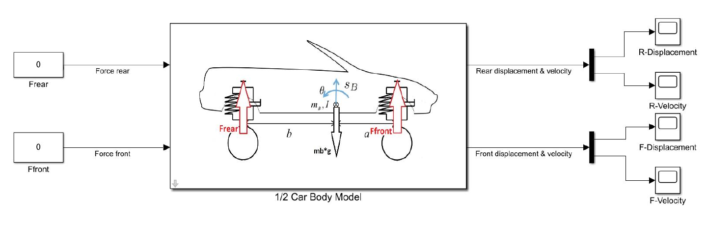
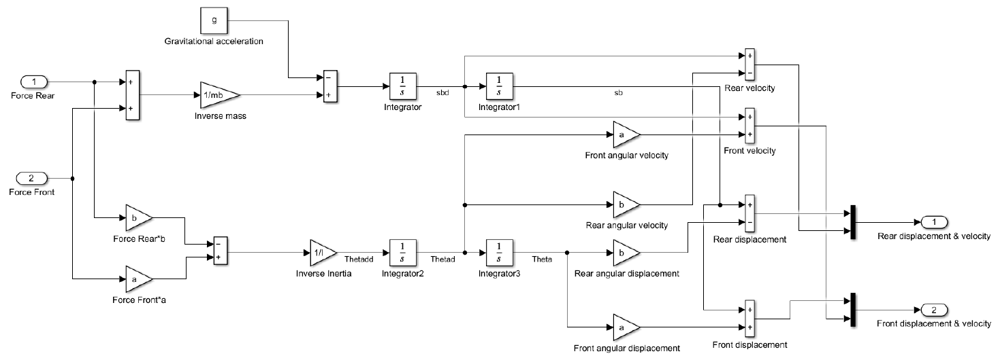

# Half-car ride model (Simulink)

A Simulink model of a half car: the body with heave and pitch, plus front and
rear suspension and wheels. It simulates the vertical ride response to road
inputs, such as a bump or a sinusoidal road at a chosen speed.



## Models

| File | What it does |
|---|---|
| [`models/half_car_body.slx`](models/half_car_body.slx) | Body only. Inputs: front and rear suspension forces. Outputs: front and rear vertical displacement and velocity. |
| [`models/half_car.slx`](models/half_car.slx) | Body, suspensions and wheels on a flat road. The car settles to its static ride height. Change the `Road Input` step blocks to apply a bump. |
| [`models/half_car_sine_road.slx`](models/half_car_sine_road.slx) | Full model on a sinusoidal road. The rear wheel sees the same profile, delayed by wheelbase / speed. |

Open a model in MATLAB/Simulink (R2021b or later) and press **Run**. All
parameters are in the block dialogs (double-click a block), so no setup script
is needed. Results show in the Scope blocks.

## How it works

**Body.** The body is a rigid beam with mass `mb` and pitch inertia `I`. The
front and rear suspension forces act at distances `a` and `b` from the centre
of mass:

```
mb · s̈B = Ffront + Frear − mb · g
I  · θ̈  = a · Ffront − b · Frear
```

The vertical displacement at each suspension point is `sB + a·θ` (front) and
`sB − b·θ` (rear), for small pitch angles.



**Suspension.** Each corner has a spring and a damper between the body and the
wheel:

* The spring is linear with stiffness `ks` up to a travel of `x0`. Beyond that
  its stiffness rises to `20·ks`, which acts as a bump stop.
* The damper is asymmetric: `cc` in compression and `ce` in extension.

**Wheel.** Each wheel is a mass `mw` on a linear tyre spring `kt` that follows
the road profile.

**Sinusoidal road.** The road has a 1 m wavelength and amplitude `h`. At speed
`v`, the wheels see a frequency of `v / 3.6` Hz, and the rear input lags the
front by `(a + b) / (v / 3.6)` seconds.

## Parameters

| Symbol | Meaning | Value |
|---|---|---|
| `mb` | Body mass | 500 kg |
| `I` | Body pitch inertia | 600 kg·m² |
| `a`, `b` | Centre of mass to front / rear axle | 1.25 m, 1.4 m |
| `mw` | Wheel mass | 20 kg |
| `kt` | Tyre stiffness | 140 000 N/m |
| `ks` | Spring stiffness | 20 000 N/m |
| `x0` | Travel where the spring stiffens | 0.2 m |
| `cc`, `ce` | Damping in compression / extension | 600, 1200 N·s/m |
| `h` | Road amplitude | 0.1 m (sine road model) |
| `v` | Speed | 10 km/h (sine road model) |

## Background

I built this model in 2022 for the Engineering Systems Simulation module of
the MSc in Automotive Engineering at the University of Bath.

## License

[MIT](LICENSE)
